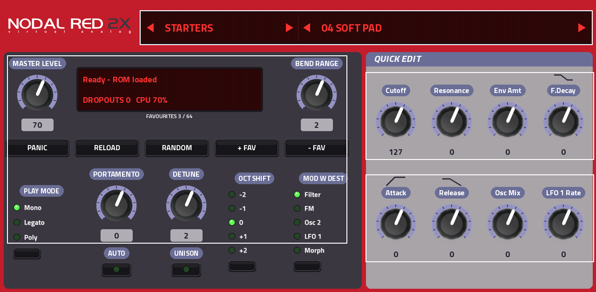
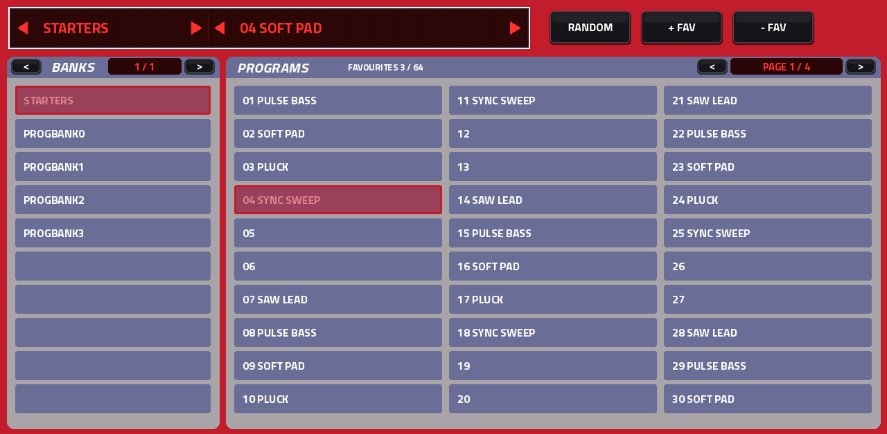
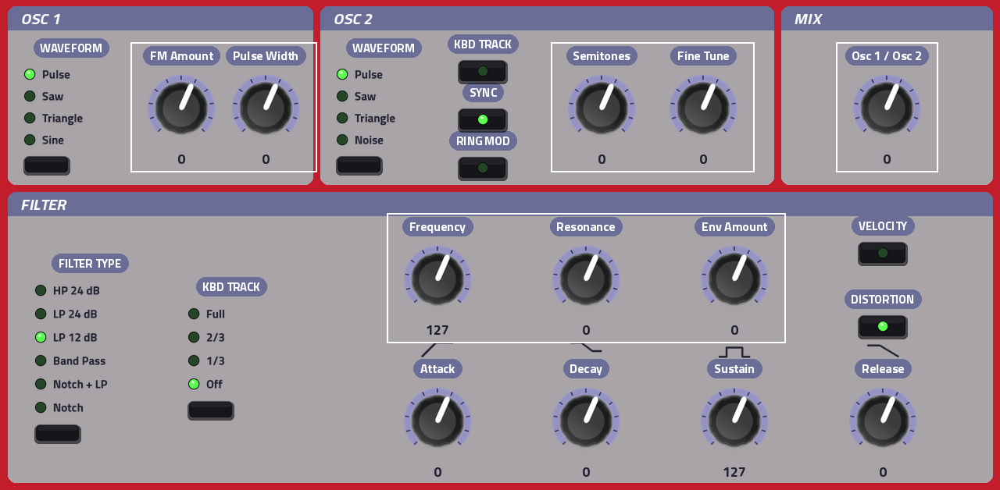

# NodalRed2x for MPC

A Clavia Nord Lead 2x emulation that runs as a plugin instrument on **Akai MPC Gen2 standalone devices** (MPC Live III and other aarch64 MPCs),
with a full touchscreen editor and Q-Link control.

It runs the Nord Lead 2x's original firmware on [gearmulator](https://github.com/dsp56300/gearmulator)'s emulation of the synth's chips (its 68331
controller and two DSP56362 voice DSPs). "NodalRed2x" is gearmulator's name for its Nord Lead 2x plugin; the look comes from its "n2xTrancy" skin by theusualsuspects.



## Features
- **The real engine:** the original firmware runs on emulated hardware: two oscillators with sync, ring mod and FM, the multimode filter with
  distortion, three envelopes, two LFOs, the arpeggiator and the morph amounts of the original.
- **A native MPC screen in the look of the original skin** (red, charcoal and slate), laid out like the Nord's panel: knobs on lilac scales with
  the envelope stages pictured over the ADSR knobs, the choices as green LEDs you tap, each with a black **cycle button** that steps through
  them as on the real panel, and on/off switches with their LED. 5 pages:
  - **MAIN:** the red display (bank and sound, with step arrows and the data wheel), status and CPU, master level, bend range, PANIC, RELOAD,
    RANDOM, +FAV / -FAV, the performance section (play mode, portamento with auto, detune with unison, octave shift, mod wheel destination) and
    8 quick-edit knobs
  - **BANKS:** the bank list and a sound browser, 30 sounds a page, the selected bank and sound lit, page steppers in the section headers
  - **OSC/FILTER:** both oscillators, the mix, the filter with its envelope, keyboard tracking, velocity and distortion
  - **AMP/MOD:** the amplifier envelope and gain, the mod envelope, LFO 1 and LFO 2 / arpeggiator with their sync
  - **MORPH:** the 25 morph amounts
- **Sound sets:** the instrument has no built-in patches, so NodalRed2x brings a small **STARTERS** bank of its own sounds and loads your own sound-set
  files (`.syx` / `.mid` single dumps, such as Clavia's Factory Program Library) as extra banks, 99 sounds each.
- **RANDOM:** a random sound from every loaded bank.
- **Named favourites in the MPC PRESET menu:** **+FAV** opens an on-screen keyboard with the sound's name (up to 20 characters); edit it and SAVE,
  then pick it from MPC's own preset list. **-FAV** removes it. Up to 64 favourites, kept across projects.
- **Follows MPC's tempo:** while MPC plays, a synced LFO 2 and the arpeggiator run at MPC's tempo.
- **Q-Links:** each page's knobs in blocks of four, one block per Q-Link column.
- **Saved with your project:** the current sound and every edit come back when the project is reopened. Projects saved with 0.1.0 still load.
- **Clean output:** audio reaches the MPC in floating point, so loud sounds don't clip in the plugin.



## Requirements
- An MPC Gen2 standalone device (aarch64, e.g. MPC Live III) running **MPC OS 3.10 or later**. Gen1 devices and the Force aren't supported.
- **Your own Nord Lead 2x ROM:** a 512 kB flash dump (`.bin`). No ROM is included, and none may be shared.
- This is the heaviest synth port of the family: it needs about one and a half of the fast cores' worth of CPU, so keep an eye on the DROPOUTS readout.

## Install
Either:
- **`NodalRed2x-<version>-mpc-sdk.zip`** from [Releases](https://github.com/sd88me/mpc-vst-nodalred2x/releases): copy the folder
  `sd88me - VST - NodalRed2x` into a `VST2 Plugins` folder at the root of a drive the MPC can see, put your ROM in its `nodalred2x/roms/` and any
  sound sets in `nodalred2x/banks/` (the file name becomes the bank name). Turn on **Preferences > Enhancements (Beta) > Enable Enhancements and
  External Plugin Support**, then restart. Load **NodalRed2x** on a plugin track from External Plugins.
- **`NodalRed2x-<version>-mpc-aarch64.zip`** (or the OpenMPC Plugin Manager): runs `install.sh` on the device; a 0.1.0 install is upgraded in place
  and your ROM, sound sets and favourites are kept.

Upgrading a 0.1.0 install from the `VST2-Plugins` zip by copying the new folder over it also works: NodalRed2x keeps using `VST/nodalred2x/`
(ROM, banks, favourites) while there is no `nodalred2x/` folder beside it.

The firmware boots in about 2 seconds.

## Tips
- Notes from the MPC play part A on MIDI channel 1.
- A MIDI program change picks a sound from the current bank; bank select (CC 0) picks the bank.
- **RELOAD** reverts the edits to the stored sound. **PANIC** stops stuck notes.
- **MOD > LFO 2 / ARPEGGIATOR:** set the destination to an arp mode (Up, Down, Up/Down, Random, Echo) to run the arpeggiator; its rate is LFO 2's Rate,
  or a note value with Sync set.
- The Nord Lead's dumps carry no names. A text file next to a bank, with the same name and `.txt` (one sound name per line), names its sounds.
  For Clavia's factory banks, `tools/names_from_pdf.py <Factory Program Library List.pdf> <banks folder>` writes them from your copy of
  Clavia's list (bank files ending in their bank number: `bank0.syx` ... `bank3.syx`).



## Building from source
You need Docker, Python 3 with Pillow, a checkout of [mpc-vst-plugins](https://github.com/open-mpc/mpc-vst-plugins) (`MPC_VST`, default
`~/mpc-vst-plugins`) and the MPC plugin builder SDK (`MPC_SDK`, default `~/mpc-plugin-builder-sdk`).
```
tests/run.sh                  # offline host test of the native plugin (x86, ASan/UBSan) with your ROM in data/roms
./build-sdk.sh                # aarch64 plugin folder in build/sdk/ (./build-sdk.sh beta: "NodalRed2x 2 Beta", its own uid)
tools/make_tui.py --preview   # the native skin (skins/) and offline previews in docs/skin-preview/
tools/package_catalog.sh      # dist/NodalRed2x-<version>-mpc-aarch64.zip, -mpc-sdk.zip, SHA256SUMS
```
`tools/gen_sdk_params.py` keeps the released parameter order (`params.lock`, append only). `src/VENDORED.md` lists the small local patches to
the vendored gearmulator source.

## Credits
NodalRed2x for MPC is built on other people's work. See [CREDITS.md](CREDITS.md) for the details.
- **[gearmulator](https://github.com/dsp56300/gearmulator)** by dsp56300 and contributors: the Nord Lead 2x emulation and the NodalRed2x plugin it comes from.
- **The "n2xTrancy" skin** by theusualsuspects: the background, the lettering and the knobs.
- **[mpc-vst-plugins](https://github.com/open-mpc/mpc-vst-plugins):** the MPC plugin wrapper and skin tools.

## Licence
**GPL-3.0**: see [LICENSE](LICENSE). The bundled components keep their own licences (GPL-3.0, zlib, BSD/LGPL, SIL OFL 1.1), as listed in CREDITS.md.

*NodalRed2x for MPC is an independent project, not affiliated with or endorsed by Clavia or Nord Keyboards. "Nord Lead" is the name of the instrument it emulates.
Nord and Clavia are trademarks of their owners.*
