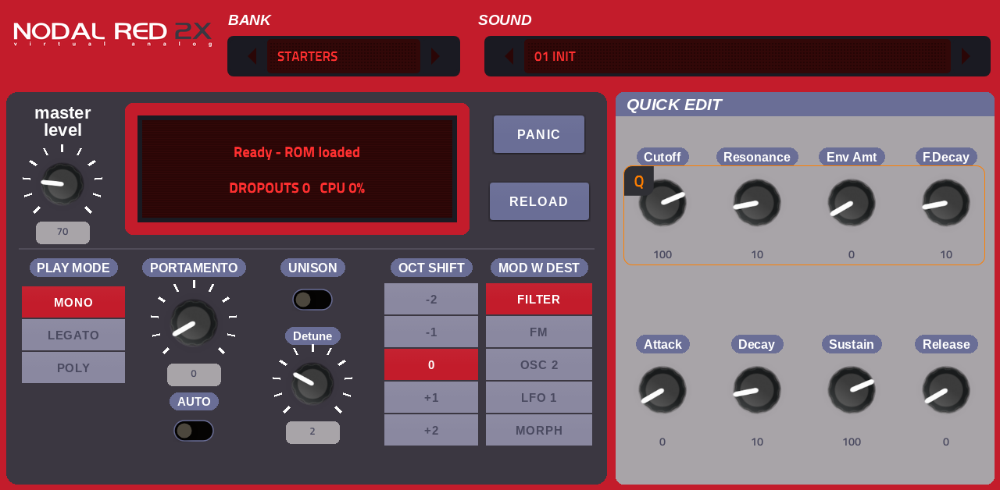
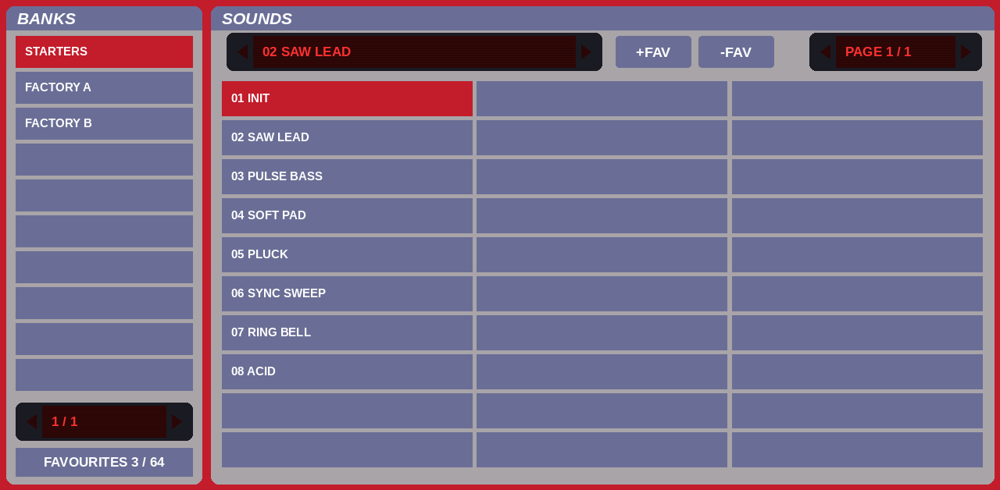
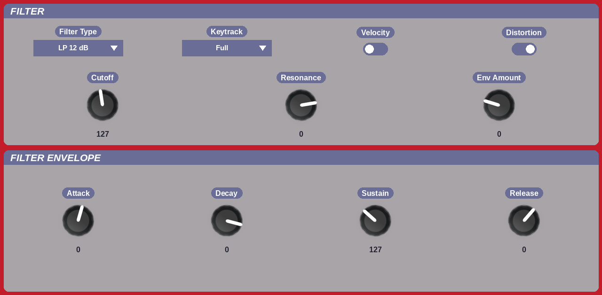

# NodalRed2x for MPC

A Clavia Nord Lead 2x emulation that runs as a plugin instrument on **Akai MPC Gen2 standalone devices** (MPC Live III and other aarch64 MPCs),
with a full touchscreen editor and Q-Link control.

It runs the Nord Lead 2x's original firmware on [gearmulator](https://github.com/dsp56300/gearmulator)'s emulation of the synth's chips (its 68331
controller and two DSP56362 voice DSPs). "NodalRed2x" is gearmulator's name for its Nord Lead 2x plugin; the look comes from its "n2xTrancy" skin by theusualsuspects.



## Features
- **The real engine:** the original firmware runs on emulated hardware: two oscillators with sync, ring mod and FM, the multimode filter with
  distortion, three envelopes, two LFOs, the arpeggiator and the morph amounts of the original.
- **Sound sets:** the instrument has no built-in patches, so NodalRed2x brings a small **STARTERS** bank of its own sounds and loads your own sound-set
  files (`.syx` / `.mid` single dumps, such as Clavia's Factory Program Library) as extra banks, 99 sounds each.
- **Favourites in the MPC PRESET menu:** press **+FAV** on any sound to save it, then pick it from MPC's own preset list. **-FAV** removes it.
  Up to 64 favourites, kept across projects.
- **A complete editor on the touchscreen:** 7 pages.
  - **MAIN:** bank and sound, status, PANIC, RELOAD and 18 quick-edit knobs
  - **BANKS:** the bank list and a sound browser, 30 sounds a page, favourites
  - **OSC**, **FILTER**, **AMP**, **MOD** (both LFOs, mod envelope, mod wheel, arpeggiator) and **MORPH** (the 25 morph amounts)
- **Follows MPC's tempo:** while MPC plays, a synced LFO 2 and the arpeggiator run at MPC's tempo.
- **Q-Links:** each page's knobs are mapped to the Q-Links.
- **Saved with your project:** the current sound and every edit come back when the project is reopened.



## Requirements
- An MPC Gen2 standalone device (aarch64, e.g. MPC Live III) running **MPC OS 3.10 or later**. Gen1 devices and the Force aren't supported.
- **Your own Nord Lead 2x ROM:** a 512 kB flash dump (`.bin`). No ROM is included, and none may be shared.
- This is the heaviest synth port of the family: it needs about one and a half of the fast cores' worth of CPU, so keep an eye on the DROPOUTS readout.

## Install
1. Download `NodalRed2x-<version>-VST2-Plugins.zip` from [Releases](https://github.com/sd88me/mpc-vst-nodalred2x/releases) and unzip it.
2. Copy the `VST2 Plugins` folder to the root of a drive the MPC can see. If that drive already has a `VST2 Plugins` folder, copy the
   `sd88me - VST - NodalRed2x` folder into it.
3. Put your ROM in `VST2 Plugins/sd88me - VST - NodalRed2x/VST/nodalred2x/roms/`.
4. Optional: put sound-set files (`.syx` or `.mid`) in `.../VST/nodalred2x/banks/`. The file name becomes the bank name.
5. On the MPC, turn on **Preferences > Enhancements (Beta) > Enable Enhancements and VST2 Support**, then restart.
6. Load **NodalRed2x** on a plugin track from the External VST Plugins list.

The firmware boots in about 2 seconds.

## Tips
- Notes from the MPC play part A on MIDI channel 1.
- A MIDI program change picks a sound from the current bank; bank select (CC 0) picks the bank.
- **RELOAD** reverts the edits to the stored sound. **PANIC** stops stuck notes.
- **MOD > LFO 2 / ARPEGGIATOR:** set the destination to an arp mode (Up, Down, Up/Down, Random, Echo) to run the arpeggiator; its rate is LFO 2's Rate,
  or a note value with Sync set.
- Sounds from files have no names (the Nord Lead's dumps carry none): they show as their number.



## Building from source
You need Docker, Python 3 with Pillow, and a checkout of [mpc-vst-plugins](https://github.com/open-mpc/mpc-vst-plugins). Point `MPC_VST` at it
(the default is `~/mpc-vst-plugins`).
```
./build.sh test               # x86 engine + the wrapper's host test (ASan/UBSan)
./build.sh all                # aarch64 vst/build/aarch64/nodalred2x.so + the skin
tools/package_310.sh 0.1.0    # dist/NodalRed2x-0.1.0-VST2-Plugins.zip
tools/preview.py out/         # offline previews of every page
```
`build/<arch>/nodalred2x_engine_test <dir with roms/>` boots the ROM and checks notes, sounds, parameters, the arpeggiator and the saved state.
Run the aarch64 one on the device. `src/VENDORED.md` lists the small local patches to the vendored gearmulator source.

## Credits
NodalRed2x for MPC is built on other people's work. See [CREDITS.md](CREDITS.md) for the details.
- **[gearmulator](https://github.com/dsp56300/gearmulator)** by dsp56300 and contributors: the Nord Lead 2x emulation and the NodalRed2x plugin it comes from.
- **The "n2xTrancy" skin** by theusualsuspects: the background, the lettering and the knobs.
- **[mpc-vst-plugins](https://github.com/open-mpc/mpc-vst-plugins):** the MPC plugin wrapper and skin tools.

## Licence
**GPL-3.0**: see [LICENSE](LICENSE). The bundled components keep their own licences (GPL-3.0, zlib, BSD/LGPL, SIL OFL 1.1), as listed in CREDITS.md.

*NodalRed2x for MPC is an independent project, not affiliated with or endorsed by Clavia or Nord Keyboards. "Nord Lead" is the name of the instrument it emulates.
Nord and Clavia are trademarks of their owners.*
